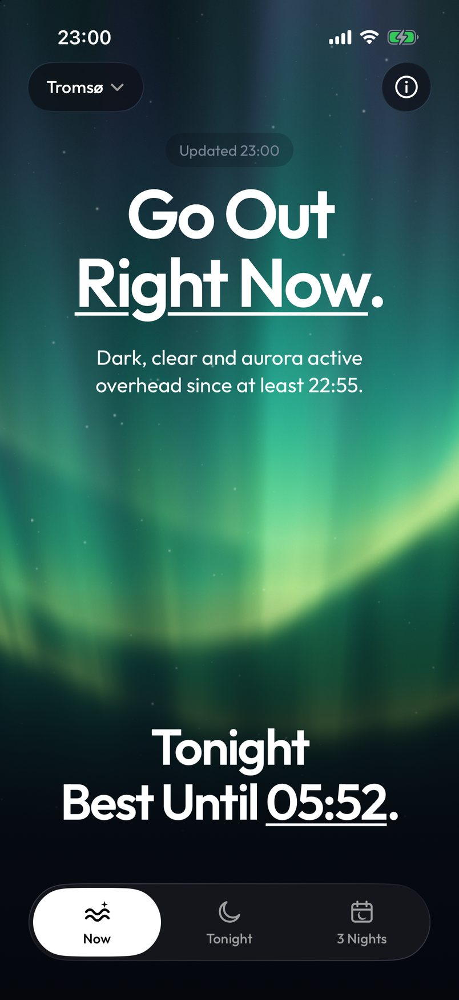
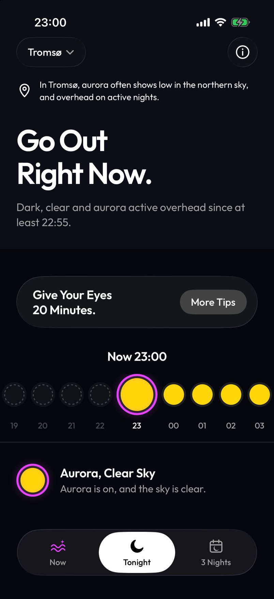
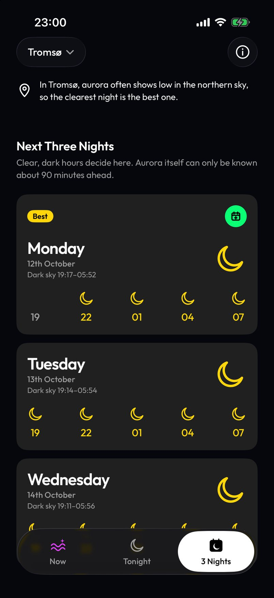

# Zorja

**Should you go out to see the aurora tonight?** Zorja is an iPhone app that answers that question in plain words. It weighs darkness, cloud cover and aurora activity for your place and tells you to go now, wait for a better hour, or skip tonight, with an outlook for the next three nights.

[](https://apps.apple.com/app/id6833883953)

[zorja.app](https://zorja.app) · [Design in Figma](https://www.figma.com/design/aoeRKZh2khWgHNtaCmxZ55/Zorja-App---Public?node-id=86-688) · [Privacy](https://zorja.app/privacy/) · [Support](https://zorja.app/support/)

<p align="center">
  
  &nbsp;
  
  &nbsp;
  
</p>

## What it does

- **Now** says whether it is worth going out at this moment, and why not if it isn't: daylight, clouds, quiet aurora, or data that is out of date.
- **Tonight** lays out the hours from sunset to sunrise, so you can see when the sky is dark, clear and active at the same time.
- **3 Nights** gives a planning outlook for the next three nights and marks the best one, with Add To Calendar.
- **Places** keeps your saved places on the phone. Search, pick on a map, or use your location once.
- **Tips** has a 20-minute dark-adaptation timer, a red screen and camera advice.

Zorja covers Northern Europe (Sweden, Norway, Finland, Denmark, Iceland, the Faroe Islands and Scotland), Poland and Canada. It handles polar night, midnight sun, twilight and the change of seasons.

## Principles

- **Real viewing conditions first.** A strong aurora at noon or behind thick cloud is not good news. Darkness and clouds count as much as activity.
- **Honest about uncertainty.** The viewing assessment is experimental. It is never shown as a percentage or a validated probability, and short-term aurora data is never stretched into future nights.
- **Unknown is not bad.** Missing, out-of-date and unfavourable conditions are shown as different states.
- **Words, not numbers.** Guidance is plain English, not a Kp index or a score.
- **Private by design.** No account, no ads, no tracking. Only a rough area (about 1 km) is sent to get a forecast, in the request body, never in a URL or log. Saved places stay on the phone.

## How it works

```
iPhone app ──POST /v1/forecast──▶ Forecast API (FastAPI on Vercel)
                                     │
             ┌───────────────────────┼──────────────────────┐
             ▼                       ▼                      ▼
   NOAA aurora grid + Kp     MET Norway weather    Sun and darkness (computed locally)
             ▲
   collector every 10 minutes (QStash) ─▶ shared cache (Upstash Redis)
```

The app sends a rough location and time zone. The backend combines NOAA's short-term aurora model (OVATION) and Kp forecast, MET Norway's hourly cloud forecast and its own sun and twilight calculations, then returns structured guidance that the app only presents. All the science lives in the backend.

Read more in [architecture](docs/architecture.md), the [forecast model](docs/forecast-model.md), the [assessment rules](docs/assessment-rules.md), [data sources](docs/data-sources.md) and the [API](docs/api.md), whose contract is [api/openapi.json](api/openapi.json).

## Repository

| Path | What it is |
| --- | --- |
| [`ios/`](ios) | The SwiftUI app (iOS 26, Swift 6) with unit tests and an accessibility audit UI test. |
| [`backend/`](backend) | The Python 3.13 forecast API, provider adapters, astronomy, the evaluator and the collector. |
| [`api/`](api) | The frozen v1 OpenAPI contract and example responses for every forecast state. |
| [`site/`](site) | The [zorja.app](https://zorja.app) website, served as static assets on Cloudflare Workers. |
| [`docs/`](docs) | Product brief, forecast model, API, privacy, hosting and the [decisions](docs/decisions.md) behind them. |
| [`tools/`](tools) | Contract checker, local site server and image helpers. |

## How it was built

Designed by [Tomas Minarik](https://tomasminarik.com) in Figma, screen by screen, and built with [Claude Code](https://claude.com/claude-code). [AGENTS.md](AGENTS.md) holds the working rules. Hosting runs entirely on free tiers.

## Credits and licence

Aurora data: NOAA Space Weather Prediction Center (public domain). Weather data: [MET Norway](https://api.met.no), licensed under NLOD 2.0 and CC BY 4.0. Typeface: Outfit, SIL Open Font License 1.1.

Copyright © 2026 Tomas Minarik. All rights reserved. The source is published for viewing; see [LICENSE](LICENSE).
